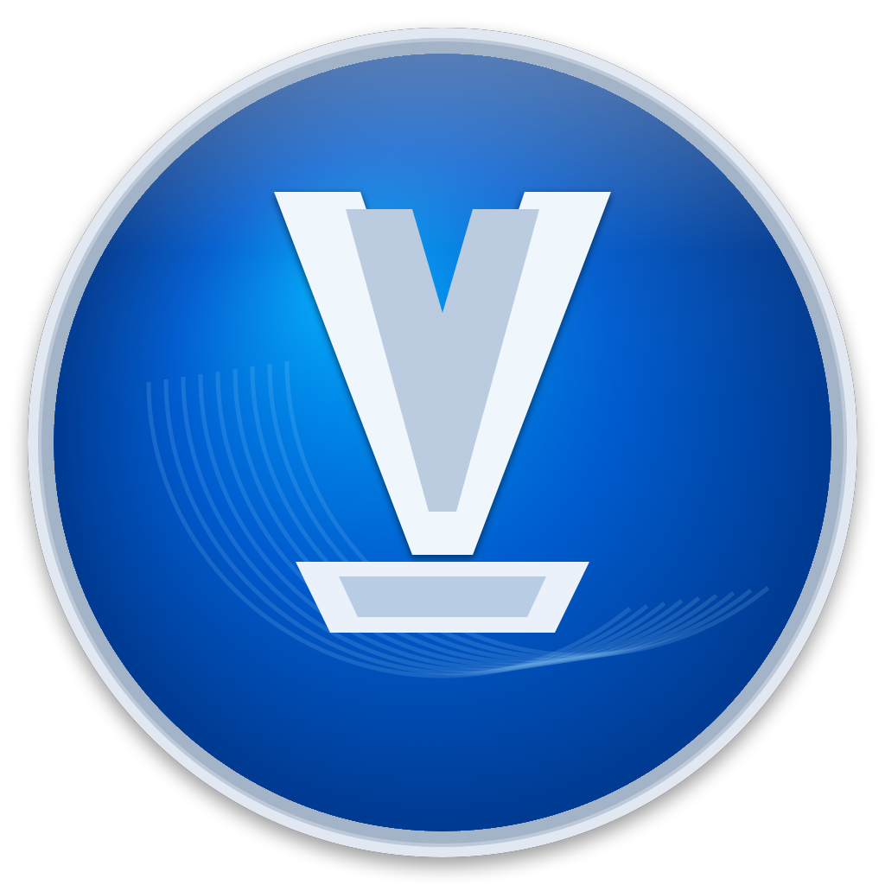

<p align="center">
  
</p>

<h1 align="center">Vidarr</h1>

<p align="center">
  <strong>マウスで描いて、Webを進む。</strong><br>
  ジェスチャーで操る、Macのための軽量ブラウザ。
</p>

<p align="center">
  macOS 14+ · iPhone / iPad版を開発中 · 日本語
</p>

**Vidarr** は、Magic Mouseやトラックパッドのジェスチャーでタブを切り替え、ページを移動できるブラウザです。画面をボタンで埋めず、Webページを見たまま、よく使う操作を手元で済ませることを目指しています。

macOS版はAppKitとWebKitで動作します。iPhone / iPad向けのSwiftUI版も同じリポジトリで開発しています。

## 主な機能

- **描いて操作** — タブの切り替え、戻る・進む、再読み込み、検索、新しいタブなどをジェスチャーから実行できます。感度や割り当ては設定画面で変更できます。
- **用途で分けるタブグループ** — 通常、プライベート、ワーク、リサーチに加え、自分用のグループを作れます。グループごとにタブ、Cookie、サイトデータを分離します。
- **プライベートグループ** — セッション復元、書き出し、通常グループからのタブ検索、閉じたタブ履歴に情報を残しません。外部リンクの自動振り分け設定もMacの認証で保護します。
- **タブを失わない仕組み** — セッション復元、閉じたタブの復元、保護タブ、非アクティブタブの自動休止に対応しています。
- **ブラウジングを一か所で管理** — 履歴、ブックマーク、ダウンロード、サイト権限をそれぞれ専用画面で確認できます。タブや履歴を横断するコマンドパレットもあります。
- **Webの追跡を減らす設定** — 追跡パラメータの除去、広告・追跡スクリプトのブロック、ポップアップ抑止、DNT / GPC、有害サイト警告を選べます。

## ジェスチャー

初期設定では、次の操作を割り当てています。

| ジェスチャー | 操作 |
| --- | --- |
| `←` / `→` | 次のタブ / 前のタブ |
| `L` / `LL` | 現在のタブを閉じる / すべてのタブを閉じる |
| `U` | 閉じたタブを復元 |
| `O` / `◎` | 現在のタブを再読み込み / すべてのタブを再読み込み |
| `↑→` / `↑←` | 戻る / 進む |
| `S` | アドレスバーにフォーカス |
| `↓←` | 新しいタブ |

ジェスチャーはMagic Mouse、トラックパッド、右クリックを押しながらのドラッグで入力できます。設定画面には、本番と同じ認識処理を使うジェスチャーテストがあります。

## 対応環境

| 項目 | 状況 |
| --- | --- |
| macOS | macOS 14 Sonoma以降 |
| iPhone / iPad | iOS / iPadOS 17以降。現在はソースからの開発ビルドのみ |
| Webエンジン | WebKit |
| UIの言語 | 日本語 |

## インストール

[Releases](https://github.com/mani1261790/Vidarr/releases)から最新の`Vidarr-*.dmg`をダウンロードします。

1. DMGを開き、`Vidarr.app`を`Applications`フォルダへドラッグします。
2. `Vidarr.app`を開きます。

> [!IMPORTANT]
> v0.1.12以降の配布ビルドはDeveloper IDで署名し、Appleの公証を通しています。ダウンロード元はこのGitHub Releasesに限定してください。

## ソースからビルドする

Xcodeで`Vidarr.xcodeproj`を開き、目的のターゲットを選んで実行します。

| プラットフォーム | Scheme | Run destination |
| --- | --- | --- |
| Mac | `Vidarr` | My Mac |
| iPhone | `VidarrPhone` | iPhone実機またはSimulator |
| iPad | `VidarrPad` | iPad実機またはSimulator |

実機で動かす場合は、各ターゲットの「Signing & Capabilities」でTeamを設定してください。

### テスト

```sh
xcodebuild \
  -project Vidarr.xcodeproj \
  -scheme Vidarr \
  -destination 'platform=macOS' \
  test -only-testing:VidarrTests
```

## データとパスワード

現在のMac版では、ブックマーク、履歴、開いているタブ、Cookie、サイトデータ、ダウンロード一覧、サイト権限を端末内に保存します。iCloud同期はまだ有効にしていません。

ログインページでは、編集メニューの「Fill Login from Keychain…」からmacOS Keychainの資格情報を選択して入力できます。選択中にページやサイトが変わった場合は入力を中止し、Vidarr自身はパスワードを保存・一覧取得しません。ブラウザ向けManaged Entitlementが必要なパスキーは現在サポートしていません。

プライベートグループの外部リンク振り分けルールはKeychainに保存し、端末のロック解除中だけ読み取れるようにしています。

## フィードバック

不具合や機能のリクエストは[Issues](https://github.com/mani1261790/Vidarr/issues)へ。不具合の場合は、OSのバージョン、利用していたデバイス、再現手順を添えてください。

## ライセンス

このリポジトリは[MIT License](LICENSE)で公開しています。
